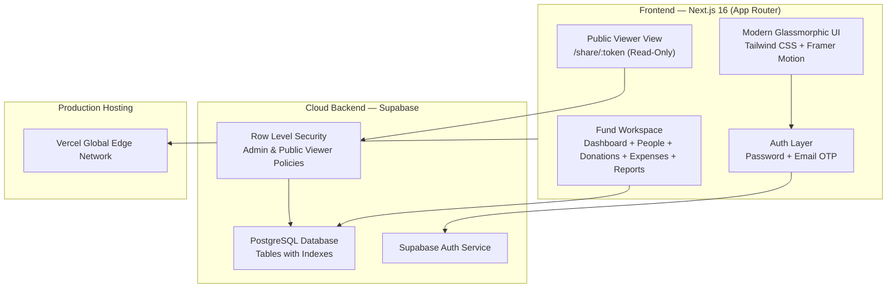

# 🏦 MultiFundManage V6

> **Next-Generation Cloud-Synced Multi-Event Fund & Financial Management Platform**  
> *Built with Next.js 16 (App Router), React 19, Supabase (PostgreSQL + Auth + RLS), Tailwind CSS, Framer Motion, and Recharts.*  
> *Crafted with ❤️ by A N I N D Y A.*

[](https://vercel.com/new)
[](https://nextjs.org/)
[](https://react.dev/)
[](https://supabase.com/)
[](https://tailwindcss.com/)

---

## 📖 Overview

**MultiFundManage** is a comprehensive, production-ready financial tracking and ledger platform designed for managing multiple community or private event funds (such as **Puja, Picnic, Weddings, Vacations, Society Maintenance, and Office Events**).

It eliminates spreadsheet chaos by introducing:
- **Cloud-synchronized database** (Supabase PostgreSQL).
- **Role-based security**: Password & Email OTP authentication for administrators, plus read-only public share links for general viewers.
- **Bi-directional people & donation linking** with typeahead auto-fill.
- **Collision-proof human-readable transaction IDs**.
- **Automated 30-day Trash Bin** recovery.
- **Professional PDF & Image reports** with official letterhead and signatory footers.
- **Full Dark / Light mode glassmorphic UI**.

---

## 🌟 Key Features

### 1. 🔐 Authentication & Access Control
- **Dual Login Methods**:
  - **Password Login**: Secure password authentication with Supabase Auth.
  - **Email OTP**: One-time 6-digit passcode sent to registered emails.
  - Restricted registration: Open signups can be locked to invited emails only.
- **Account Settings**: Change password at any time from the UI without admin intervention.
- **Viewer-Only Share Links**: Generate unique links (`/share/{token}`) allowing general attendees or society members to monitor collections and expenses live without logging in or seeing admin controls.

### 2. 🗂️ Multi-Fund Workspace & 30-Day Trash Bin
- Create unlimited independent event funds with event types (Puja, Picnic, Wedding, Trip, Meeting, Custom).
- **Soft Delete to Trash**: Any fund can be moved to the Trash bin where it is safely stored for **30 days** before permanent removal.
- **One-Click Restore**: Easily recover deleted funds back into active rotation.
- **Grid / List Views**: Toggle between visual card grids and compact tabular rows with real-time fuzzy search.

### 3. 🆔 Collision-Proof Unique IDs
Every entity automatically receives a unique, human-readable ID based on date stamps and randomized sequences:
- **Members**: `PER-YYMMDD-XXXXX`
- **Donations**: `DON-YYMMDD-XXXXX`
- **Expenses**: `EXP-YYMMDD-XXXXX`
- **Receipts**: `RCP-YYMMDD-XXXXX`

### 4. 🔄 Bi-Directional Member & Donation Sync
- Adding a donation for a new name automatically creates the member in the **People** directory.
- Adding a person first auto-suggests their name in a smart dropdown when logging donations, auto-populating their designation.

### 5. 📊 Fund Workspace (Tabs)
- **Dashboard**:
  - Metric summary cards (Total Collected, Total Expenses, Net Surplus/Deficit, Member Count).
  - Category-wise Expense distribution (interactive Doughnut chart).
  - Payment mode distribution (Cash, UPI, Bank, Cheque).
  - Daily trend chart (Income vs Outflow area chart).
  - Top 5 Donors leaderboard with animated progress bars.
  - Live chronological activity feed.
- **People Tab**: Member registry with phone numbers, designations, and pledge tracking.
- **Donations Tab**: Date, donor, amount, payment mode, reference ID, receipt number, and remarks.
- **Expenses Tab**: Date, category, description, amount, vendor/paid-to, payment mode, and approval signatures.
- **Reports Tab**:
  - **PDF Export**: Clean A4 format report with header letterhead, metric cards, itemized tables, and authorized signatory footer.
  - **Image (PNG) Export**: Export high-resolution shareable summary images.
  - **Print Ready**: Optimized print styles for physical documentation.
  - Filter by date range or report type (Full Summary, Donation Register, Expense Register, Category Breakdown, People Directory).
- **Settings Tab**: Update event details, manage custom categories with color pickers, export offline JSON backups, and manage **Viewer Share Links**.

---

## 🏗️ Architecture & Tech Stack



| Layer | Technology | Description |
|---|---|---|
| **Framework** | Next.js 16.4 (App Router) | High-performance React framework with Turbopack |
| **Language** | TypeScript 5 | Strict end-to-end type safety |
| **Styling** | Tailwind CSS v4 | Utility-first, responsive, and glassmorphic styling |
| **Animations** | Framer Motion | Smooth layout shifts, modals, and list animations |
| **Charts** | Recharts | Dynamic SVG graphs (Doughnut, Bar, Area, Line) |
| **Database** | Supabase (PostgreSQL) | Fully managed PostgreSQL with real-time API |
| **Security** | Row Level Security (RLS) | Database-enforced access boundaries |
| **PDF Export** | jsPDF + html2canvas | High-fidelity vector/canvas PDF and image generation |
| **State** | Zustand | Lightweight persistent theme and app state |
| **Hosting** | Vercel | Automatic deployments and serverless edge delivery |

---

## 🛠️ Step-by-Step Setup from Scratch

Follow this guide to run or deploy MultiFundManage from an empty machine.

### Prerequisites
- [Node.js](https://nodejs.org/) (version 18.18 or 20+ recommended)
- [Git](https://git-scm.com/)
- A free [Supabase](https://supabase.com) account
- A free [Vercel](https://vercel.com) account (for online hosting)

---

### Step 1: Clone the Repository
```bash
git clone https://github.com/anindyawbsedcl/multifundmanage.git
cd multifundmanage
```

---

### Step 2: Install Dependencies
```bash
npm install
```

---

### Step 3: Set Up Supabase Database

1. Log in to [Supabase](https://supabase.com/dashboard) and click **"New Project"**.
2. Give your project a name (e.g. `multifundmanage`) and choose a strong database password.
3. Once initialized, navigate to the **SQL Editor** (`>_` icon on the left menu).
4. Click **"+ New Query"**.
5. Copy the entire contents of [`supabase/schema.sql`](supabase/schema.sql) and paste it into the editor.
6. Click the green **"Run"** button. This will create:
   - Tables: `funds`, `categories`, `people`, `donations`, `expenses`, `share_links`.
   - Foreign keys, cascading deletes, and performance indexes.
   - Row Level Security (RLS) policies for administrators and public viewers.
   - API schema grants for `anon` and `authenticated` roles.

7. **Disable Email Confirmation for Instant Login**:
   - Go to **Authentication** → **Sign In / Providers** → **Email**.
   - Toggle OFF **"Confirm email"** and click **Save**.

---

### Step 4: Configure Environment Variables

Create a file named `.env.local` in the project root:

```env
NEXT_PUBLIC_SUPABASE_URL=https://your-project-id.supabase.co
NEXT_PUBLIC_SUPABASE_ANON_KEY=your-supabase-publishable-anon-key
```

*(You can find both values in your Supabase dashboard under **Project Settings → API**).*

---

### Step 5: Run the Development Server Locally

```bash
npm run dev
```

Open [http://localhost:3000](http://localhost:3000) in your web browser.

1. Click on the **"Register"** tab.
2. Enter your email and desired password to create your Admin account.
3. Sign in to start creating funds, adding donors, tracking expenses, and viewing charts!

---

### Step 6: Deploy to Vercel (Online HTTPS URL)

#### Via Vercel CLI (Recommended):
```bash
# Link project
npx vercel link --project multifundmanage --yes

# Add Environment Variables
"https://your-project-id.supabase.co" | npx vercel env add NEXT_PUBLIC_SUPABASE_URL production
"your-anon-key" | npx vercel env add NEXT_PUBLIC_SUPABASE_ANON_KEY production

# Deploy to production
npx vercel --prod --yes
```

#### Via Vercel Web Dashboard:
1. Push your code to GitHub.
2. Go to [Vercel Dashboard](https://vercel.com/dashboard) and click **"Add New" → "Project"**.
3. Import your `multifundmanage` repository.
4. Under **Environment Variables**, add:
   - `NEXT_PUBLIC_SUPABASE_URL`
   - `NEXT_PUBLIC_SUPABASE_ANON_KEY`
5. Click **"Deploy"**. Your application will be live at `https://your-app.vercel.app`!

---

## 📁 Project Directory Structure

```
MultiFundManage/
├── public/                     # Static assets & icons
├── src/
│   ├── app/                    # Next.js 16 App Router
│   │   ├── (auth)/
│   │   │   └── login/page.tsx  # Dual login & registration (Password + OTP)
│   │   ├── fund/[fundId]/      # Fund workspace dynamic routes
│   │   │   ├── layout.tsx      # Tab navigation header with Suspense
│   │   │   ├── dashboard/      # Real-time metrics & Recharts graphs
│   │   │   ├── people/         # Member registry with unique IDs
│   │   │   ├── donations/      # Donation logging with auto-add donor
│   │   │   ├── expenses/       # Expense tracking with category filters
│   │   │   ├── reports/        # PDF & Image export engine
│   │   │   └── settings/       # Fund configuration & public share links
│   │   ├── home/page.tsx       # Multi-fund list & 30-day trash bin
│   │   ├── settings/page.tsx   # Admin account & password change
│   │   ├── share/[token]/      # Public read-only viewer page
│   │   ├── globals.css         # Tailwind CSS v4 & theme variables
│   │   ├── layout.tsx          # Root layout with attribution badge
│   │   └── page.tsx            # Root redirect logic
│   ├── components/
│   │   └── shared/
│   │       ├── theme-provider.tsx  # Dark/Light theme provider
│   │       └── theme-toggle.tsx    # Interactive theme switcher
│   ├── lib/
│   │   ├── supabase/           # Server, Client & Middleware Supabase clients
│   │   ├── stores/             # Zustand persistent stores
│   │   ├── id-generator.ts     # Collision-proof ID generation algorithm
│   │   ├── types.ts            # Complete TypeScript interfaces
│   │   └── utils.ts            # Currency formatter (₹), date helpers, cn
│   └── middleware.ts           # Route guard and session refresher
├── supabase/
│   └── schema.sql              # Complete PostgreSQL database schema + RLS
├── scripts/
│   └── migrate.js              # Direct database migration utility
├── .env.example                # Template for environment variables
├── next.config.ts              # Next.js configuration
├── package.json                # Project dependencies and scripts
└── tsconfig.json               # TypeScript compiler options
```

---

## 📄 Database Schema Reference

The database consists of 6 primary PostgreSQL tables:

1. **`funds`**: Stores event funds (title, event type, date ranges, soft-delete status, owner UUID).
2. **`categories`**: Fund-specific expense categories (e.g., Food, Decoration, Transport, Sound & Light).
3. **`people`**: Members associated with a fund, with phone number, designation, and expected pledge.
4. **`donations`**: Contribution entries tied to a member and fund, with payment mode (Cash, UPI, Bank) and receipt ID.
5. **`expenses`**: Outflow records tied to a category, with amount, paid-to vendor, payment mode, and approval notes.
6. **`share_links`**: Cryptographic tokens for public read-only viewer access.

---

## 🔒 Security Best Practices

- **Row Level Security (RLS)** is enabled on all tables: users can only view and mutate funds they own.
- **Service Role Key is never exposed** on the frontend; only public anon keys are used.
- **Passwords are hashed** with bcrypt via Supabase Auth.
- Public viewer links only grant read-only access to specific funds tied to that token.

---

## 🤝 Contributing

Contributions, issues, and feature requests are welcome!
Feel free to open an issue or submit a Pull Request.

---

## 📜 License

This project is licensed under the MIT License — see the [LICENSE](LICENSE) file for details.

---

<p align="center">
  <b>Made with ❤️ by A N I N D Y A</b>
</p>
